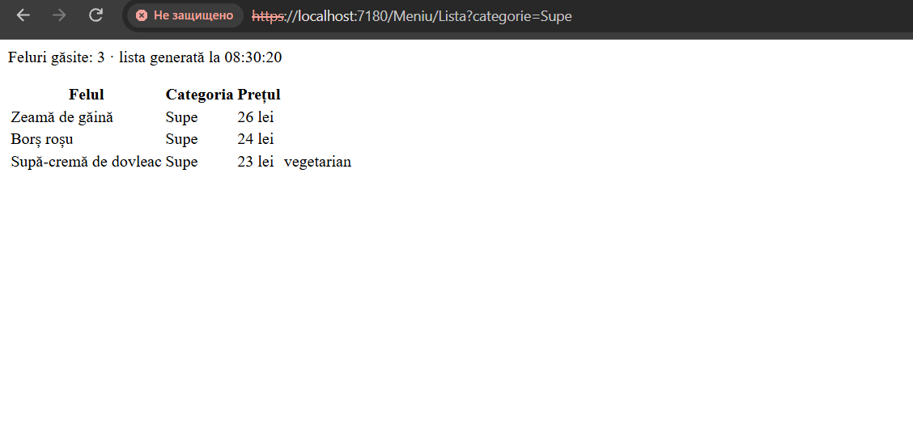
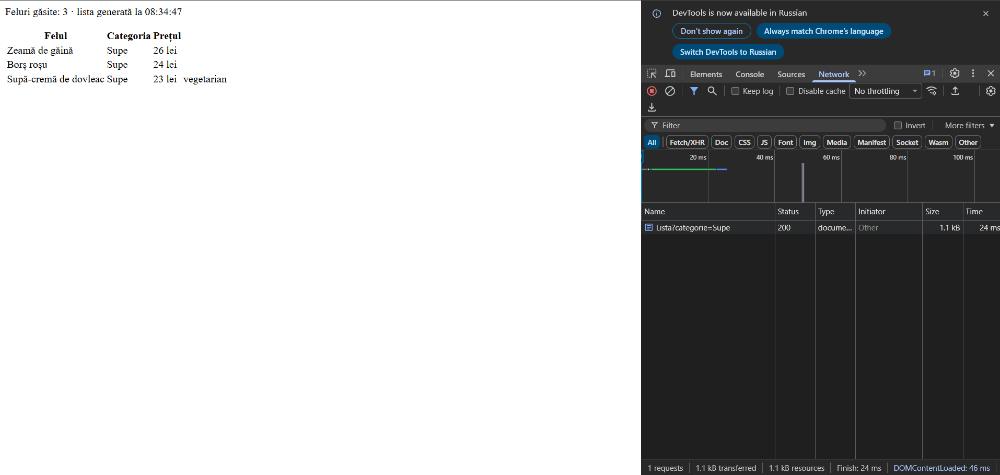
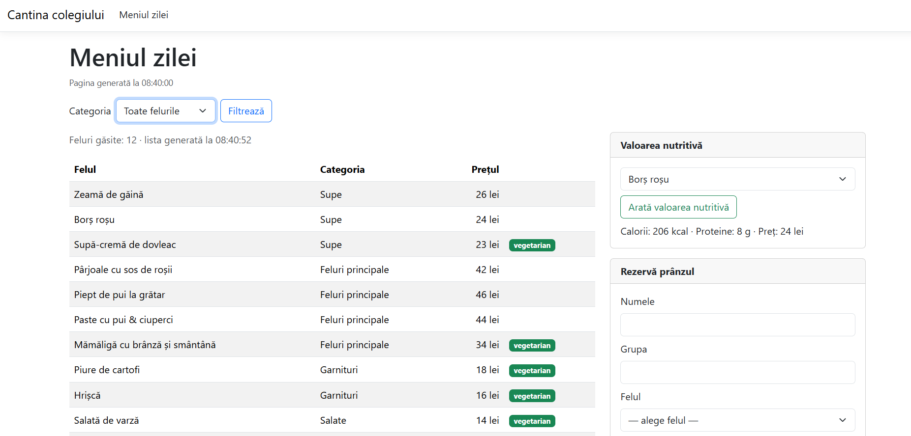
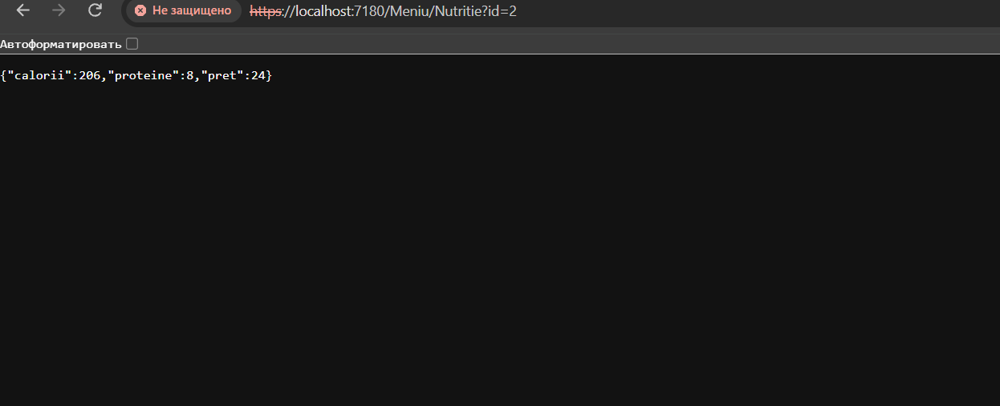
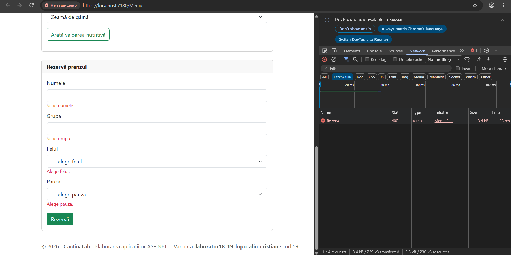
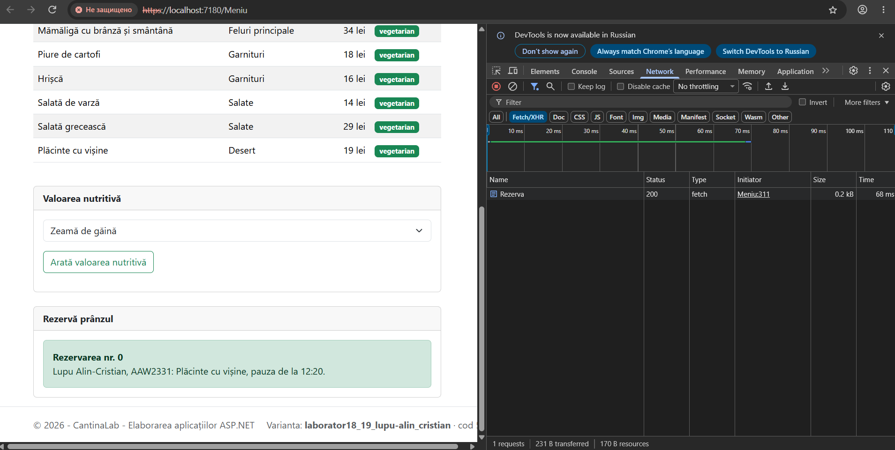

# Raportul laboratorului nr. 18

**Cereri asincrone cu fetch și date trimise acțiunilor** · proiectul `CantinaLab`

| | |
|---|---|
| **Numele și prenumele** | *(scrie aici)* |
| **Grupa** | AAW2341 |
| **Data** | 04.11.2026 |
| **Ramura** | `lab-18` |
| **Varianta** (din subsolul paginii) | *(scrie aici, de exemplu `popescu-ion · cod 37`)* |

> **Cum completezi raportul**
>
> 1. La fiecare punct de control din fișă faci o captură de ecran (**Win+Shift+S**, apoi **Salvează** din notificare) și o salvezi în folderul `Raport/capturi/`, cu numele exact din tabel. În captură trebuie să se vadă subsolul paginii, cu varianta ta.
> 2. În coloana **Ce s-a întâmplat** scrii pe scurt ce ai văzut. Unde scrie **„scrie valoarea”**, treci valoarea din aplicația ta: ea diferă de la un elev la altul.
> 3. Nu scrie explicații. Întrebările ți le pune profesorul la susținere.
> 4. Raportul intră în commit-ul `Raport`, înainte de Pull Request.

## Tabelul de testare

| Nr. | Sarcina | Ce faci | Ce trebuie să se întâmple | Ce s-a întâmplat | Captura |
|---|---|---|---|---|---|
| 1 | S1 | Deschizi în browser adresa `/Meniu/Lista?categorie=Supe`. | Doar tabelul, fără meniu și fără stiluri: „Feluri găsite: 3”. | | `lab18-1.png` |
| 2 | S2 | Deschizi **F12 → Network → Fetch/XHR** și alegi *Garnituri* în listă. | Lista arată doar garniturile. Ora paginii nu se schimbă. În Network: `Lista?categorie=Garnituri`, codul 200. | | `lab18-2.png` |
| 3 | S3 | Alegi *Borș roșu* și apeși **Arată valoarea nutritivă**. | Sub buton: „Calorii: … kcal · Proteine: … g · Preț: … lei”. **Scrie valorile.** | | `lab18-3.png` |
| 4 | S3 | Deschizi direct, în browser, adresa JSON a felului 2, apoi aceeași adresă cu 99 în loc de 2. | Felul 2: textul JSON. Felul 99: eroarea 404. **Scrie adresa.** | | `lab18-4.png` |
| 5 | S4 | Trimiți formularul **Rezervă prânzul** gol. | Mesajele apar lângă câmpuri. În Network: cererea POST cu codul 400. Ora paginii nu se schimbă. | | `lab18-5.png` |
| 6 | S4 | Completezi formularul corect și îl trimiți. | În locul formularului: „Rezervarea nr. …”. **Scrie numărul.** | | `lab18-6.png` |

## Capturile

### 1. Sarcina 1

### 2. Sarcina 2

### 3. Sarcina 3

### 4. Sarcina 3

### 5. Sarcina 4

### 6. Sarcina 4

## Commit-urile

Verifică în **Git → View Branch History** că pe ramura `lab-18` există, în ordine:

- [ ] `S1: acțiunea Lista cu PartialView`
- [ ] `S2: filtrul cu fetch`
- [ ] `S3: valoarea nutritivă în JSON`
- [ ] `S4: rezervarea trimisă cu fetch`
- [ ] `Raport`
