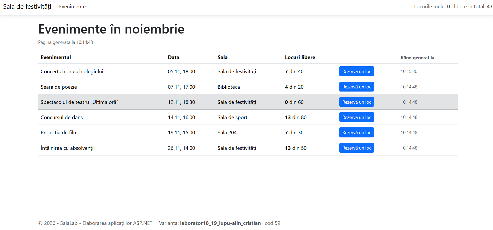
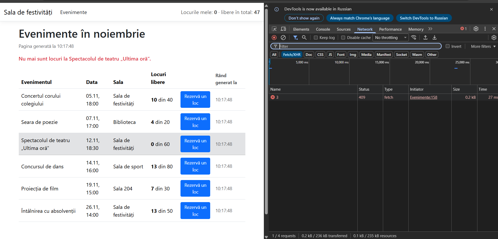
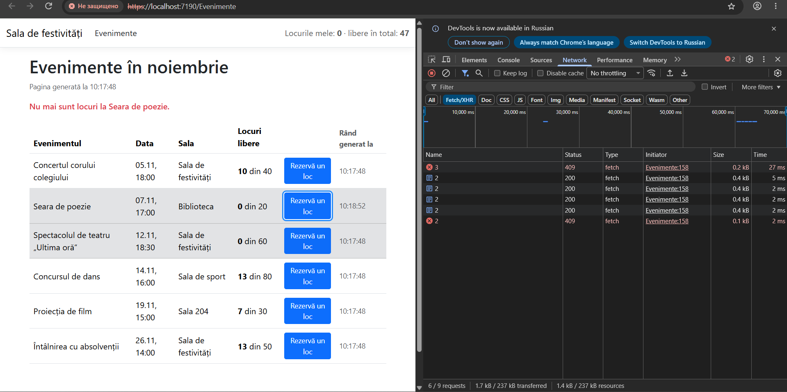
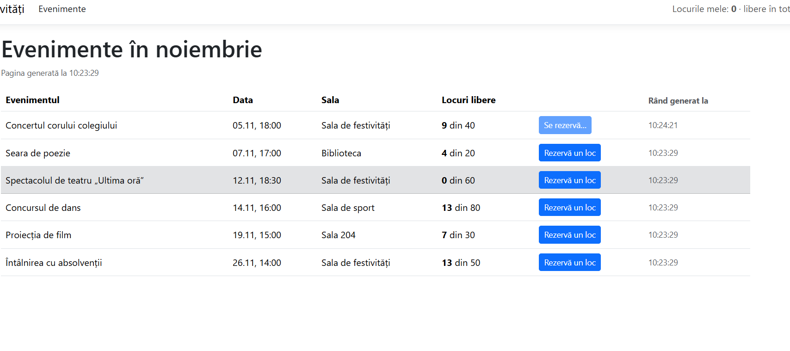
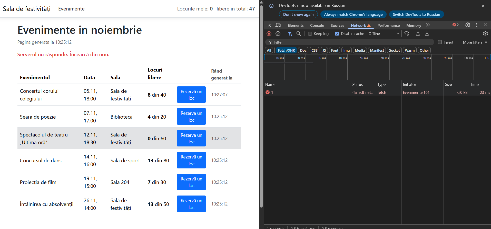
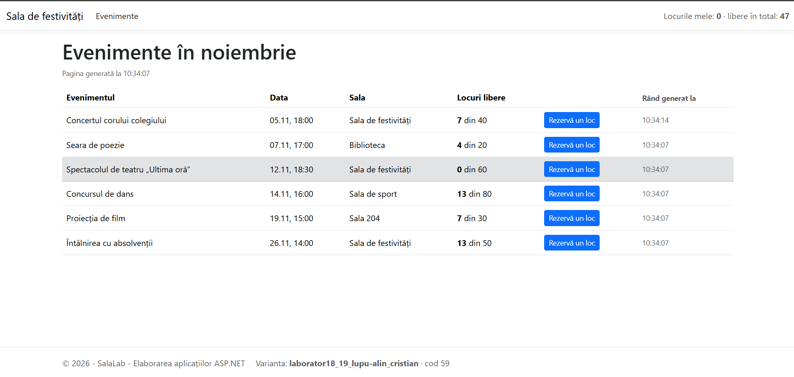

# Raportul laboratorului nr. 19

**Actualizarea parțială a paginii și tratarea răspunsurilor** · proiectul `SalaLab`

| | |
|---|---|
| **Numele și prenumele** | *(scrie aici)* |
| **Grupa** | AAW2341 |
| **Data** | 04.11.2026 |
| **Ramura** | `lab-19` |
| **Varianta** (din subsolul paginii) | *(scrie aici, de exemplu `popescu-ion · cod 37`)* |

> **Cum completezi raportul**
>
> 1. La fiecare punct de control din fișă faci o captură de ecran (**Win+Shift+S**, apoi **Salvează** din notificare) și o salvezi în folderul `Raport/capturi/`, cu numele exact din tabel. În captură trebuie să se vadă subsolul paginii, cu varianta ta.
> 2. În coloana **Ce s-a întâmplat** scrii pe scurt ce ai văzut. Unde scrie **„scrie valoarea”**, treci valoarea din aplicația ta: ea diferă de la un elev la altul.
> 3. Nu scrie explicații. Întrebările ți le pune profesorul la susținere.
> 4. Raportul intră în commit-ul `Raport`, înainte de Pull Request.

## Tabelul de testare

| Nr. | Sarcina | Ce faci | Ce trebuie să se întâmple | Ce s-a întâmplat | Captura |
|---|---|---|---|---|---|
| 1 | S1 | Apeși **Rezervă un loc** la *Concertul corului colegiului*. | Se schimbă doar rândul Concertului: un loc mai puțin și ora rândului nouă. Ora paginii rămâne. | | `lab19-1.png` |
| 2 | S2 | Apeși **Rezervă un loc** la *Spectacolul de teatru*. | Deasupra tabelului: „Nu mai sunt locuri la …”. În Network: codul 409. | | `lab19-2.png` |
| 3 | S2 | La *Seara de poezie* rezervi până nu mai sunt locuri, apoi mai apeși o dată. | La ultimul clic apare mesajul cu 409. **Scrie câte rezervări au reușit.** | | `lab19-3.png` |
| 4 | S3 | Apeși **Rezervă un loc** la *Concursul de dans*, cu fila Network deschisă. | Butonul devine gri și scrie „Se rezervă…”. În Network, cererea durează aproximativ 1 s. | | `lab19-4.png` |
| 5 | S3 | Oprești aplicația (**Shift+F5**), lași pagina deschisă și apeși **Rezervă un loc**. | „Serverul nu răspunde. Încearcă din nou.” Butonul revine la „Rezervă un loc”. | | `lab19-5.png` |
| 6 | S4 | Pornești din nou aplicația (**F5**) și faci 3 rezervări la *Concert*. | Fără reîncărcare, antetul arată „Locurile mele: 3” și locurile libere în total. **Scrie totalul.** | | `lab19-6.png` |

## Capturile

### 1. Sarcina 1

### 2. Sarcina 2

### 3. Sarcina 2

### 4. Sarcina 3

### 5. Sarcina 3

### 6. Sarcina 4

## Commit-urile

Verifică în **Git → View Branch History** că pe ramura `lab-19` există, în ordine:

- [ ] `S1: rândul actualizat cu outerHTML`
- [ ] `S2: codul 409 și mesajul serverului`
- [ ] `S3: așteptarea și lipsa răspunsului`
- [ ] `S4: antetul actualizat din JSON`
- [ ] `Raport`
